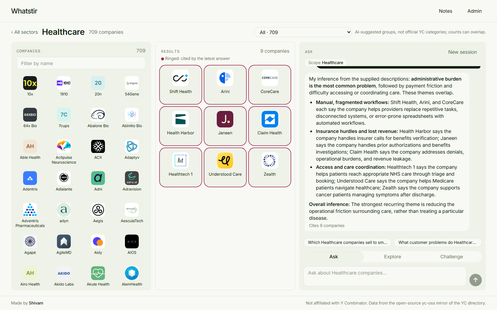
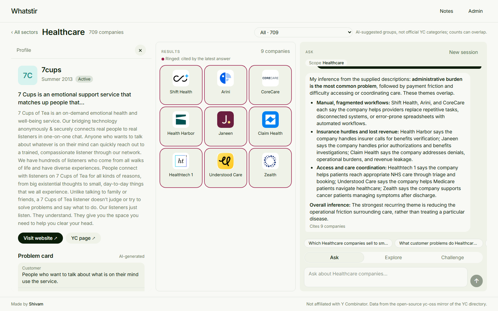
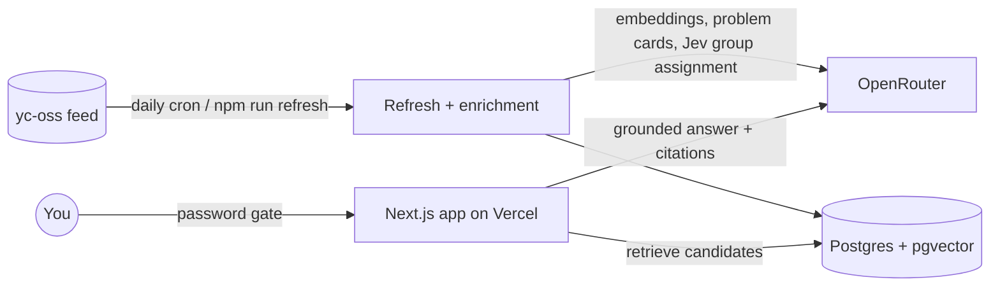

<div align="center">

# Whatstir

**Explore Y Combinator startups by sector and by the customer problems they solve.**

Pick a sector, ask questions in plain English, and watch the companies each answer relies on collect in a grid.


</div>

> [!NOTE]
> Whatstir is an independent project. It is **not affiliated with Y Combinator**. Company data comes from [yc-oss](https://github.com/yc-oss/api), an open-source mirror of the public YC directory. Read [About the data](#about-the-data) before you run your own copy.

---

## Contents

- [Features](#features)
- [Screenshots](#screenshots)
- [How it works](#how-it-works)
- [Tech stack](#tech-stack)
- [Run your own Whatstir](#run-your-own-whatstir)
  - [1. Get your own accounts and keys](#1-get-your-own-accounts-and-keys)
  - [2. Set up locally](#2-set-up-locally)
  - [3. Load the data](#3-load-the-data)
  - [4. Deploy to your own Vercel](#4-deploy-to-your-own-vercel)
  - [5. Check your deployment](#5-check-your-deployment)
- [What it costs to run](#what-it-costs-to-run)
- [Development](#development)
- [Project layout](#project-layout)
- [Documentation](#documentation)
- [About the data](#about-the-data)
- [Contributing](#contributing)
- [License](#license)
- [Credits](#credits)

## Features

- 🗺️ **Sector treemap.** About 6,400 YC companies across 9 sectors, sized by count. Filter by batch ("Fall 2026") or show active companies only.
- 🧺 **The basket.** Every company in a sector as a wall of logos, narrowed by AI-suggested problem groups ("Scheduling", "Billing", …) and by name.
- 💬 **Ask, Explore, Challenge.** Ask questions about the sector, a group, a batch or a hand-picked selection. Answers are written only from the companies' own descriptions and cite the companies they rely on.
- 🧠 **Follow-ups that remember.** Every company already discussed stays in context for the whole session, so you can just ask "Tell me more about this company".
- 🌐 **Web search when the data runs out.** Questions about news, funding or anything outside the dataset get a separate, clearly labelled "From the web" part with source links, searched through OpenRouter. Companies from your data that it names join the grid too.
- 🧩 **A grid that grows.** Each cited company flies from the basket into a results grid that builds up over the session. The latest answer's companies are ringed.
- 🔍 **Compare and profiles.** Open any company for its problem card, founders and links, or compare two or three side by side.
- 📝 **Notes.** Keep notes on companies or general notes, all listed on one page.
- 🔄 **Daily refresh.** A cron job re-reads the directory each day and enriches only new or changed companies. `/admin` shows every run.
- 🔒 **Private by default.** A single site password guards every page, and all AI and database calls run on the server.

## Screenshots

**The workspace:** the company basket, the results grid (companies cited by the latest answer are ringed) and the chat.



**A company profile,** with its description, links and AI-generated problem card.



## How it works



1. **Ingest.** `refresh` loads the yc-oss feed into Postgres. Each company is embedded (`text-embedding-3-small` by default) and given a short **problem card** written from its own description (`gpt-6-luna` by default). It's also placed in AI-suggested problem groups by **Jev** (`jev-latest`). Every AI call goes through [OpenRouter](https://openrouter.ai), with one key.
2. **Ask.** A question is embedded, and pgvector picks the closest companies in scope (sector, group, batch or selection). Companies already discussed in the session are added back, and the whole conversation goes along. The answer model (`gpt-6.1-sol` by default; any structured-output model through OpenRouter) must answer from those descriptions only and cite company ids. Citations are checked against the candidates, and the cited companies join the grid. If the model needs facts the dataset lacks, one web search through OpenRouter adds a separate, labelled part with source links.
3. **Keep fresh.** Vercel Cron calls `/api/cron/refresh` daily. Enrichment is keyed by content hashes, so unchanged companies cost nothing.

There's more depth in [docs/system-architecture-document.md](docs/system-architecture-document.md) and [docs/flow.md](docs/flow.md).

## Tech stack

| Layer | Choice |
|---|---|
| App | [Next.js 16](https://nextjs.org) (App Router, `cacheComponents`), React 19, TypeScript |
| Styling | Tailwind CSS 4. Inter, Newsreader and Fragment Mono, self-hosted via `next/font` |
| Database | Postgres with [pgvector](https://github.com/pgvector/pgvector), hosted on [Supabase](https://supabase.com), queried through [postgres.js](https://github.com/porsager/postgres) |
| AI | [OpenRouter](https://openrouter.ai) only, with one key: answers, writing and embeddings (GPT models by default, any OpenRouter model by setting), and Jev for subcategory assignment |
| Hosting | [Vercel](https://vercel.com), with Vercel Cron for the daily refresh |
| Tests | [Vitest](https://vitest.dev) (unit, integration on a real Postgres, components) and [Playwright](https://playwright.dev) (end to end) |

## Run your own Whatstir

Everything below uses **your own** accounts and keys. The repository holds no secrets: `.env` is git-ignored, and [`.env.example`](.env.example) contains placeholders only.

### Prerequisites

- [Node.js](https://nodejs.org) 22 or newer
- [Git](https://git-scm.com)
- [Docker](https://www.docker.com) (optional; only for running the test suite)

### 1. Get your own accounts and keys

| You need | Where to get it | Used for |
|---|---|---|
| A Postgres database with pgvector | Create a free project at [supabase.com](https://supabase.com) | All data |
| `OPENROUTER_API_KEY` | [openrouter.ai/keys](https://openrouter.ai/keys) (add a few dollars of credit) | Every AI call: answers, problem cards, embeddings and Jev group assignment |
| A Vercel account | [vercel.com](https://vercel.com) (the free Hobby plan is enough) | Hosting and the daily cron |

> [!TIP]
> In Supabase, open your project, click **Connect**, and copy the **Transaction pooler** connection string (port **6543**). Put your database password into it. The migrations enable the `vector` extension for you.

### 2. Set up locally

```sh
git clone https://github.com/<you>/whatstir.git
cd whatstir
npm install
cp .env.example .env        # then open .env and fill in your own values
```

Fill in `.env`:

| Variable | Value |
|---|---|
| `DATABASE_URL` | Your Supabase transaction pooler URL |
| `OPENROUTER_API_KEY` | Your OpenRouter key |
| `APP_PASSWORD` | A passphrase of your choice. Leave it empty locally to switch the gate off |
| `CRON_SECRET` | Any long random string, for example from `openssl rand -hex 32` |

Every variable is described in [docs/environment-config-reference.md](docs/environment-config-reference.md).

#### Choosing models

Every AI call goes through OpenRouter. The defaults are OpenAI's GPT models served by OpenRouter, but any model id from [openrouter.ai/models](https://openrouter.ai/models) works:

```sh
# Optional examples; check openrouter.ai/models for current ids and "structured outputs" support
AI_MODEL_ANSWER=anthropic/claude-sonnet-5.5
AI_MODEL_WRITE=openai/gpt-6.1-terra
AI_MODEL_EMBED=openai/text-embedding-3-small
JEV_MODEL=jev-1.14
```

| Setting | Default | Must support |
|---|---|---|
| `AI_MODEL_ANSWER` | `openai/gpt-6.1-sol` | Structured outputs (JSON schema) |
| `AI_MODEL_WRITE` | `openai/gpt-6-luna` | Structured outputs (JSON schema) |
| `AI_MODEL_EMBED` | `openai/text-embedding-3-small` | 1536-dimensional output |
| `JEV_MODEL` | `jev-latest` (OpenRouter's `~typesafe/jev-latest`) | A Jev model |

`/admin` shows the models a deployment is using, and warns if `OPENROUTER_API_KEY` is missing.

> [!WARNING]
> Changing the **embedding** model changes every vector, so re-embed everything afterwards: run `update companies set embedded_hash = null;` in your database, then `npm run backfill`.

> [!CAUTION]
> Never commit `.env`, and never prefix a key with `NEXT_PUBLIC_`: that would send it to the browser.

### 3. Load the data

```sh
npm run migrate                  # create the schema (and enable pgvector)
npm run refresh -- --load-only   # load ~6.4k companies from yc-oss (seconds, no AI)
npm run subcategories            # name each sector's problem groups (one model call per sector)
npm run backfill                 # embeddings, groups, problem cards and founders for everything
npm run dev                      # http://localhost:3000
```

- `backfill` shows its progress. It's safe to stop and run again, because finished work is kept. If any company fails (a timeout, say), it exits with code 1; run it again to retry only those.
- Founders aren't fetched by default, because that scrapes YC company pages (see [About the data](#about-the-data)). `FOUNDERS_FETCH=on` opts in for your own private use.
- To regenerate one sector's groups, run `npm run subcategories -- --sector healthcare`, then `npm run backfill`.

### 4. Deploy to your own Vercel

1. **Push your copy to GitHub.** A private repository works.
2. **Import it in Vercel:** **Add New → Project**, pick the repository, and keep the **Next.js** preset and the default root directory.
3. **Add environment variables** under **Settings → Environment Variables**. Tick **Production**, and **Preview** too if you want preview deployments to work:

   | Variable | Value |
   |---|---|
   | `DATABASE_URL` | The same Supabase pooler URL |
   | `OPENROUTER_API_KEY` | Your OpenRouter key |
   | `AI_MODEL_*`, `JEV_MODEL` | Optional model overrides |
   | `WEB_SEARCH` | Optional; `off` disables web search in the chat |
   | `APP_PASSWORD` | A long passphrase. **Required** once the site is public |
   | `CRON_SECRET` | A *different* random string from your local one |

   Leave `AI_FAKE`, `YC_SOURCE_URL` and `TEST_DATABASE_URL` unset. They're for tests only.
4. **Deploy.** [`vercel.json`](vercel.json) pins the functions to `iad1` (Washington, D.C.), which suits a database in `us-east-1`. If your Supabase project is in another region, change `regions` to the Vercel region nearest to it.
5. **The daily refresh is automatic.** `vercel.json` registers `/api/cron/refresh` at 11:00 UTC. Check it under **Settings → Cron Jobs**. Vercel sends your `CRON_SECRET` with each call, and requests without it get `401`.

> [!IMPORTANT]
> Load and enrich the data from your own machine (step 3) before or right after the first deploy. A full backfill takes longer than a server function may run, while daily refreshes are small.

### 5. Check your deployment

A read-only smoke suite checks a live deployment: the password gate, cron protection, treemap counts, a sector's basket and groups, a profile, notes and `/admin`. It asks nothing and writes nothing.

```sh
SMOKE_URL=https://<your-app>.vercel.app SMOKE_PASSWORD=<your APP_PASSWORD> npm run test:e2e:smoke
```

The day after you deploy, `/admin` should list a `cron` run with status **OK**.

## What it costs to run

These are rough figures from the author's own deployment, using the default GPT models at current prices. Other OpenRouter models can cost much less, or more. Check [OpenRouter's pricing](https://openrouter.ai/models).

| What | About |
|---|---|
| First full load (~6.4k companies: embeddings, groups, problem cards) | $1.40 |
| Daily refresh (only new or changed companies) | $0.01 a day |
| One question | $0.01–0.025 (plus about $0.005–0.015 when it searches the web) |
| Supabase free tier, Vercel Hobby | $0 |

## Development

```sh
npm run dev            # dev server on http://localhost:3000
npm run db:test:up     # start the test database (Docker, pgvector on port 54329)
npm test               # Vitest: unit, integration (real Postgres) and component tests
npm run test:e2e       # Playwright against a production build
npm run ci             # typecheck, lint, Vitest and Playwright, the same as the CI check
```

Tests never call OpenRouter or YC. Vitest sets `AI_FAKE=1` and `FOUNDERS_FETCH=off`, and the e2e suite serves the feed from a local fixture server, so **you can work on the code without any API keys.**

> [!NOTE]
> Much of Whatstir was built with an AI coding assistant. [`CLAUDE.md`](CLAUDE.md) and [`AGENTS.md`](AGENTS.md) are the instructions it follows, and they're also the most detailed notes on the workflow and testing rules.

## Project layout

```text
app/            Next.js routes: pages, API route handlers, the login page
components/     React components (Workspace, Basket, ResultsGrid, Chat, Treemap, Tooltips, …)
lib/            Server logic: ingestion, enrichment, retrieval, answers, sessions, notes
db/migrations/  SQL migrations (run with npm run migrate)
scripts/        CLI entry points: migrate, refresh, subcategories, backfill
e2e/            Playwright end-to-end tests and a local feed server
smoke/          Read-only checks for a live deployment
test/           Test helpers and the 37-company fixture
docs/           Requirements, architecture, API, schema, decisions and design
proxy.ts        The password gate (Next 16's renamed middleware)
vercel.json     Region and the daily cron
```

## Documentation

| Document | What's in it |
|---|---|
| [Product requirements](docs/product-requirements-document.md) | Goals, scope and acceptance criteria |
| [System architecture](docs/system-architecture-document.md) | Boundaries and data flows |
| [Technical design](docs/technical-design-document.md) | Implementation-level design |
| [API specification](docs/api-specification.md) | Every endpoint, with request and response shapes |
| [Database schema](docs/database-schema.md) | Tables, constraints and access control |
| [Data extraction](docs/data-extraction-specification.md) | Ingestion and enrichment rules |
| [Environment and config](docs/environment-config-reference.md) | Every variable and setting |
| [UI/UX and design language](docs/ui-ux-wireframes.md) | Screens, states and the visual style |
| [Decision log](docs/decision.md) | What was decided, and why |

## About the data

Whatstir reads the public YC directory through [yc-oss](https://github.com/yc-oss/api), an unofficial mirror. YC's [Terms of Use](https://www.ycombinator.com/legal) forbid scraping and the commercial use of their site's content. The yc-oss data comes from that site, and the optional founder fetch scrapes YC company pages directly.

- **Run your own copy for personal, non-commercial research,** and use the data at your own risk.
- **The founder fetch is off by default.** Turn it on (`FOUNDERS_FETCH=on`) only for private use.
- **Don't offer a hosted or paid service built on this data** without permission from Y Combinator.
- Company names, descriptions and logos belong to their owners. AI-generated summaries can be wrong, and nothing here is investment advice.

The MIT licence below covers Whatstir's **code** only. It grants no rights to YC's data or to anyone's trademarks.

## Contributing

Contributions are welcome! Start with [CONTRIBUTING.md](CONTRIBUTING.md), which covers setup without keys, the issue → branch → PR workflow and the conventions, and please follow the [Code of Conduct](CODE_OF_CONDUCT.md). Report security problems privately, as described in [SECURITY.md](SECURITY.md). Changes are listed in [CHANGELOG.md](CHANGELOG.md).

## License

[MIT](LICENSE) © 2026 Shivam Shinde.

## Credits

- Company data: [yc-oss/api](https://github.com/yc-oss/api), an open-source mirror of the public [Y Combinator directory](https://www.ycombinator.com/companies). Logos are linked from YC's CDN.
- Hero photo: ["Rolling green hills shrouded in morning fog"](https://unsplash.com/photos/rolling-green-hills-shrouded-in-morning-fog-tCU_rbybwMg) by Zetong Li on Unsplash, under the [Unsplash License](https://unsplash.com/license). It's stored in [`public/`](public/landscape-hills.jpg).
- Visual style adapted from a design on [styles.refero.design](https://styles.refero.design).
- Typefaces: [Inter](https://rsms.me/inter/), [Newsreader](https://fonts.google.com/specimen/Newsreader) and [Fragment Mono](https://fonts.google.com/specimen/Fragment+Mono), under the SIL Open Font License.

<div align="center">
<sub>Made by Shivam · Not affiliated with Y Combinator</sub>
</div>
