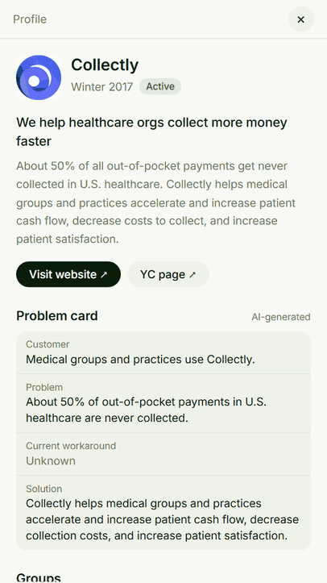

# How Whatstir works

[`whatstir-how-it-works.excalidraw`](whatstir-how-it-works.excalidraw) is an eight-slide deck that tells the project's story, from the big picture down to each stage. Every slide is a 16:9 Excalidraw frame. Open the file at [excalidraw.com](https://excalidraw.com) (Menu → Open), or with the Excalidraw extension in VS Code or Obsidian. Logos and screenshots are embedded, so it works offline.

| # | Slide | What it explains |
|---|---|---|
| 1 | What is Whatstir? | The product in three steps (browse, ask, collect), next to the home screen. |
| 2 | Six pieces, one doorway | You, the app on Vercel, Supabase Postgres, the yc-oss feed, OpenRouter and the daily cron, and how they connect. |
| 3 | Collecting the data | The daily refresh: start, lock, fetch, check, compare, save in one transaction. |
| 4 | Making sense of each company | Enrichment: embed, assign a problem group with Jev, write a problem card. Plus why only stale steps rerun. |
| 5 | From the whole directory to one company | The real screens, annotated: treemap → workspace (basket, grid, chat) → profile. |
| 6 | One company, up close | The company card, top and scrolled: who it is, its own words, links, the AI problem card, groups, founders and notes. Links to the scrolling GIF. |
| 7 | Asking a question | The answer loop: fingerprint the question, narrow to 40 candidates, answer, guardrail, optional web search, into the grid. |
| 8 | Trust, and keeping it running | Four promises the app keeps, the admin page, and how a change ships. |

The numbers on the slides come from the code: 40 candidates (`lib/retrieval.ts`), a 90% source check and two retries (`lib/refresh.ts`), batches of 50 with 4 at a time and a 240 s budget (`lib/enrich.ts`), the 11:00 UTC cron (`vercel.json`), the default models (`lib/ai.ts`) and Jev's 0.5 threshold (`db/migrations/001_init.sql`). If any of these change, update the slide.

Tool logos come from [Simple Icons](https://simpleicons.org) (CC0). The company logos in the grids on slides 1 and 7 are real YC Healthcare companies whose one-liners are about billing and payments, taken from the YC directory: Candid Health, Apero Health, CombineHealth, Syntra, Collectly, Aegis, Clearest Health, Toothy AI and Taiga. Each one takes the place of one tile color, so a company sits in the same spot on both slides. Brand names and logos belong to their owners. Screenshots are from `docs/images/`. [`company-card-scroll.gif`](../images/company-card-scroll.gif) shows Collectly's card scrolling; slide 6 shows two stills from it, because Excalidraw doesn't play GIFs. The company in slide 4 ("Acme Claims") is made up.

[`slide-1-what-is-whatstir.excalidraw`](slide-1-what-is-whatstir.excalidraw) and [`slide-7-asking-a-question.excalidraw`](slide-7-asking-a-question.excalidraw) are single-slide copies of those two slides. They don't update when the deck changes.
